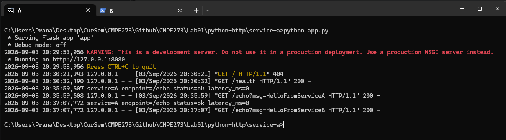
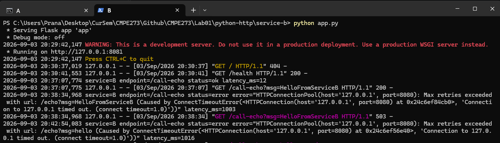
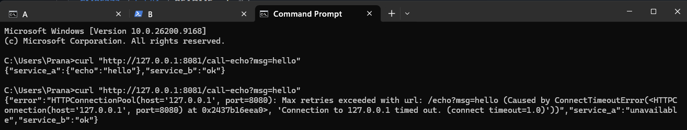
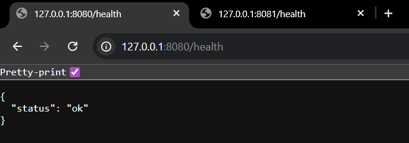
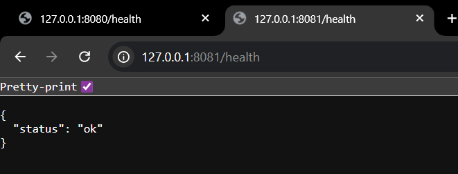
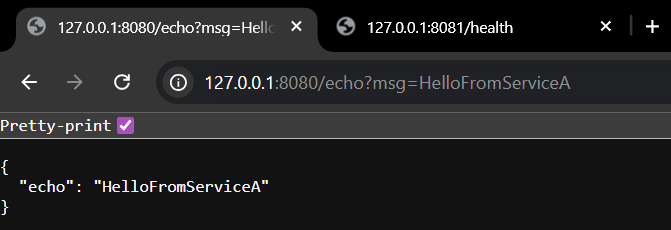
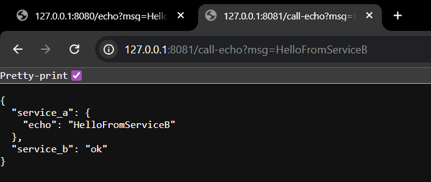
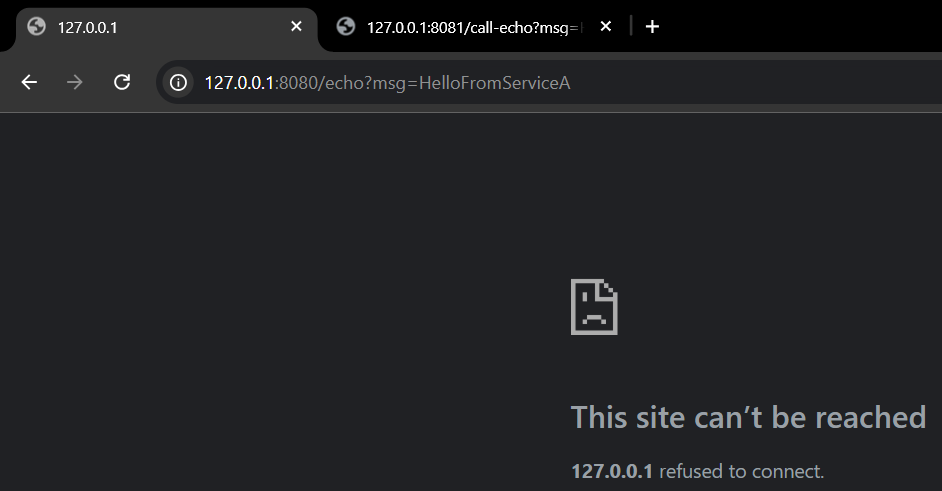
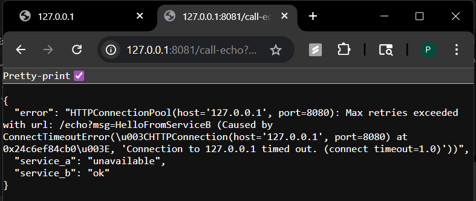

# CMPE 273 – Week 1 Lab 1: Your First Distributed System (Starter)

This starter provides two implementation tracks:
- `python-http/` (Flask + requests) (CHOSEN PATH)
- `go-http/` (net/http)

Pick **one** track for Week 1.

### Lab Goal
Build **two services** that communicate over the network:
- **Service A** (port 8080): `/health`, `/echo?msg=...`
- **Service B** (port 8081): `/health`, `/call-echo?msg=...` calls Service A

Minimum requirements:
- Two independent processes
- HTTP (or gRPC if you choose stretch)
- Basic logging per request (service name, endpoint, status, latency)
- Timeout handling in Service B
- Demonstrate independent failure (stop A; B returns 503 and logs error)

## Deliverables
## 1. Repo link : 
      https://github.com/PranavSehgalSJSU/CMPE273/tree/main/Lab01
## 2. README updates:
   # how to run locally
      The code can be run locally by cloning git repository via :
         git clone https://github.com/PranavSehgalSJSU/CMPE273.git
      then opening folder in 2 seperate terminals and running:

   **python CMPE273\Lab01\python-http\service-a\app.py**

   **python CMPE273\Lab01\python-http\service-b\app.py**

      You can now use postman/curl/browser to get outputs for hosts at 
         Domain 127.0.0.1:8080(Service A) or 127.0.0.1:8081(Service B)
   # success + failure proof (curl output or screenshot)
      Terminal outputs:

      Terminal -> 
         Curl Commands:

      Browser -> 
         Service Healths:

      
      Browser -> 
         Service Echos(Both Running):

      
      Browser -> 
         Service Echos(Only B Running):

   # 1 short paragraph: “What makes this distributed?”
   This setup is  distributed since Service A & Service B run as completely independent processes that do not share memory or local state. They instead communicate via HTTP requests, making each service operates autonomously. Service B relies entirely on network coordination w/ Service A to fulfill the /call-echo curl command.