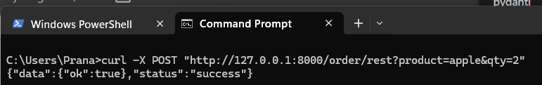
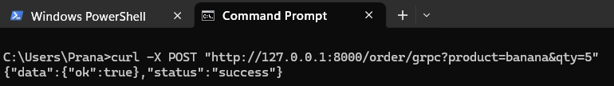
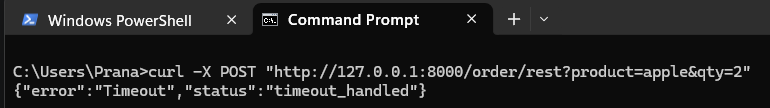
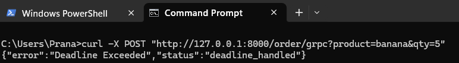
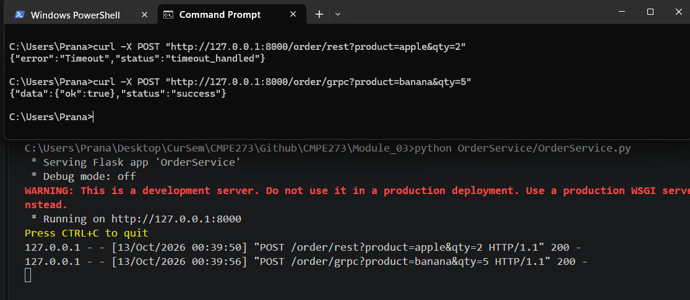
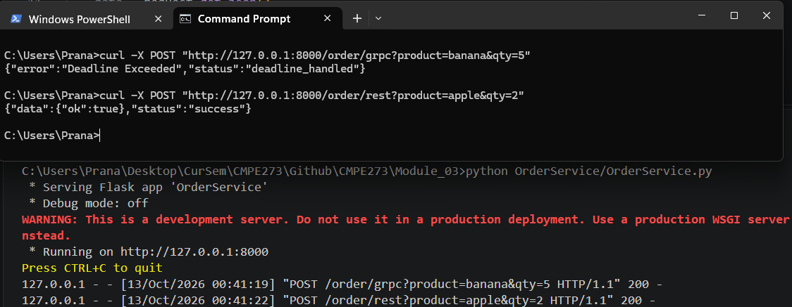

Your GitHub repository must contain a README that includes:

NOTE: Ensure you're in Module_03 folder

PreReqs :
pip install flask httpx grpcio grpcio-tools
python -m grpc_tools.protoc -I. --python_out=. --grpc_python_out=. inventory.proto

1) Instructions for running the REST version:
    -> Open terminal & run python InventoryService/RESTInventoryService.py
    -> Open another terminal & run python OrderService/OrdersService.py

2) Instructions for running the gRPC version:
    -> Open terminal & run python InventoryService\GRCPInventoryService.py
    -> Open another terminal & run python OrderService/OrdersService.py

3) Example of a successful REST request and response:

4) Example of a successful gRPC request and response.

5) Evidence of REST timeout handling:

6) Evidence of gRPC deadline handling.

7)  Evidence that the Order Service remains running after the failures
    Evidence Case 1, setting Delay True for Rest only & testing GRPC
    
    Evidence Case 2, setting Delay True for gRPC only & testing Rest
    

8) A short 4–6 sentence comparison answering: What differences did you observe between implementing the same service contract using REST and gRPC?

REST uses regular web requests and readable text which makes it very easy to test and debug.
gRPC uses efficient binary data and strict rules which makes it much faster for computers to talk to each other. REST is simple to set up and works well for basic web pages and normal apps.
gRPC handles timeouts and complex data connections much more smoothly across microservices.