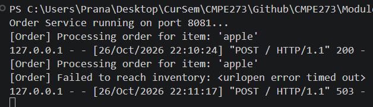
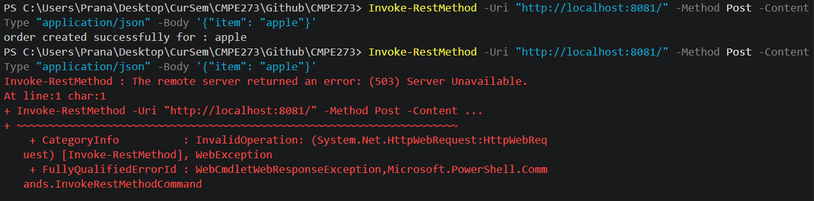
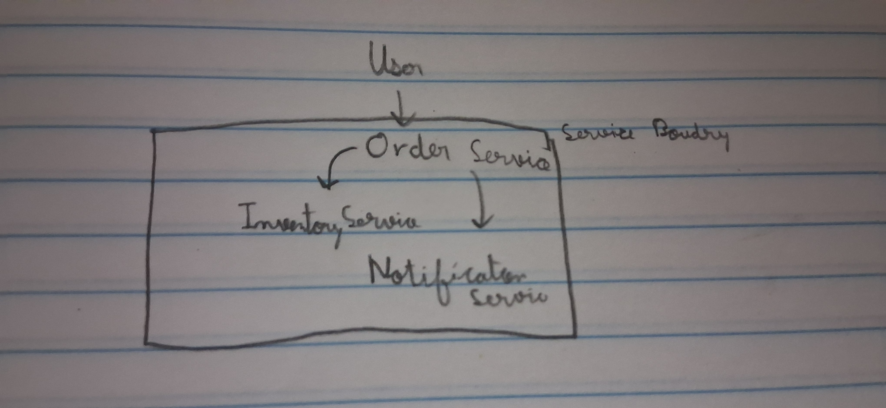
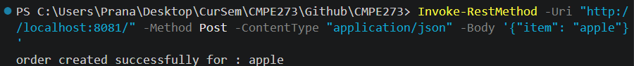
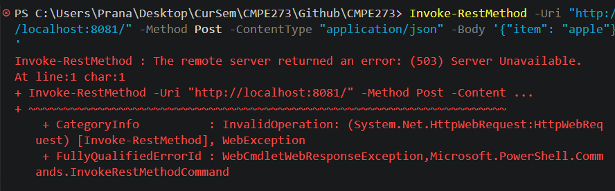
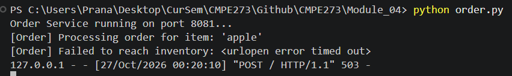

# 1. Architecture Design
## The responsibility of each component/service
Order Service: 
    Receives customer order requests, coordinates w/ inventory Service, and creates product
Inventory Service: 
    Manages the item catalog & returns stock availability.
Notification Service: 
    Sends notifications to user
## What data each component should own:
    Order Service: Order records, IDs, status
    Inventory Service: item records
    Notification Service Owns: People's contact
# 2. Command, Query, and Event
Check whether an item is available : Query (Retrieves Data, no modification)

Create an order : Command (Modifies data by adding stuff)

Order was created : Event (Nothing happens to data by this statement, it just occured)

# 3. Implementation

Implemented via code

# 4. Failure Test
Same command run with and without inventory running

# 5.Submiision
Instructions for installing dependencies and running the services
    --> No extra dependencies
    --> To run, go to Module_03 Folder, open 2 teminals in this location, and run :
        --> python order.py
        --> python inventory.py
    --> then open powershell, and run curl

Architecture diagram:

Explanation of each component's responsibility:
    Order Service: Receives customer orders, coordinates stock verification w/ Inventory Service, triggers alerts via the Notification Service, and returns the final order outcome.

    Inventory Service: checks if item requested by orderservice is avalible

    Notification Service: sends notification to user

Data ownership for each component:
    Order Service: Order records & statuses, and customer checkout lifecycles.
    Inventory Service: item dictionary & stock qty
    Notification Service:Delivery records & user contact info
    

Explanation of your chosen service boundaries:
    Each service handles a single task: Order processes transactions, Inventory manages stock, and Notification handles alerts. Keeping them separate makes the system easier to scale, update, and protect from single points of failure.

Example of a successful request:

Proof of the Inventory Service failure test:

Screenshots, terminal output, or curl output showing your implementation working

