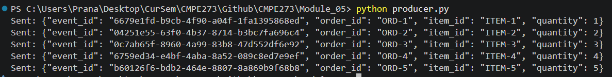
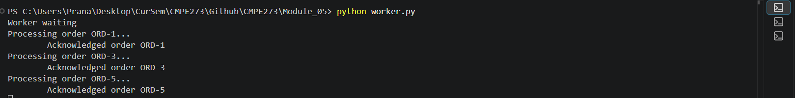
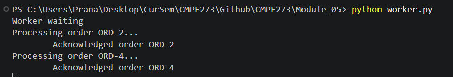
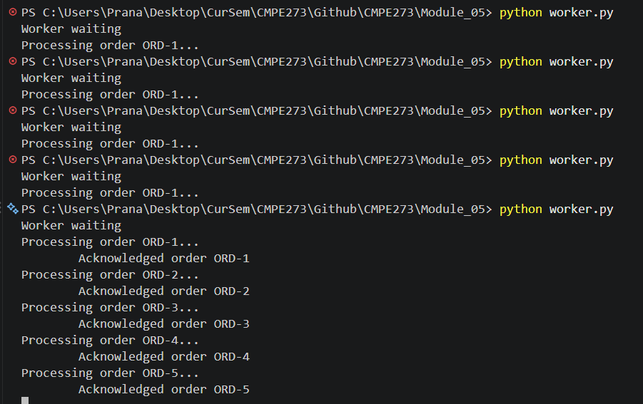
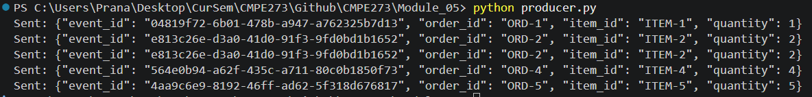
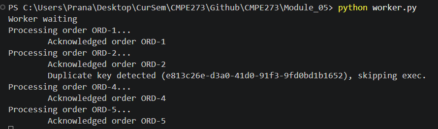

# Instructions for running RabbitMQ, producer, and workers.
    -> Install Docker and run "docker run -it --rm --name rabbitmq -p 5672:5672 -p 15672:15672 rabbitmq:4-management" in terminal
    -> pip install pika so it can talk to rabbitMQ
    -> run python worker.py in as many terminals as you want instances
    -> to simulate a crashing wokrer, set SIMULATE_CRASH = True
    -> run 1 python producer.py instance

# Simple architecture diagram.

# Example of successful message processing.
# Evidence of two competing consumers.

# Evidence of failure and redelivery.

# Evidence of duplicate handling.

# Screenshots, logs, or terminal output.
    All Screenshot images are in ./imgs

# A short 3–5 sentence reflection answering:
    Why can a message be delivered more than once, and how does idempotent handling help?

    A message could be delivered more than once as:
        A send B message
        B Proceeses it and Crashes before sending message back
        A thinks B hasn't gotten it yet, and sends message again
        B reads message again, and processes again, then send message back

    With Idempotent handling :
        A send B message
        B Proceeses it and Crashes before sending message back
        A thinks B hasn't gotten it yet, and sends message again
        B reads message again, and sees it's already processed it
        It lets A know it's processed message wihtout reprocessing
