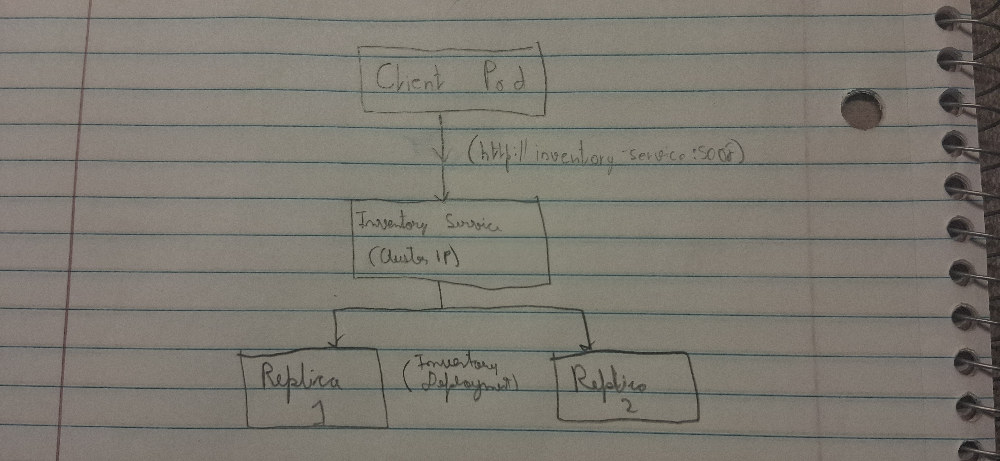
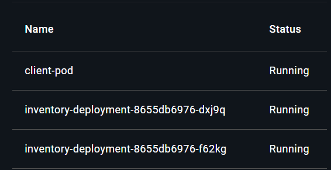
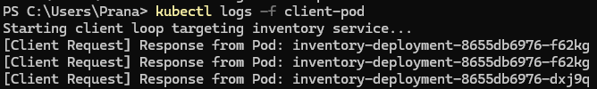
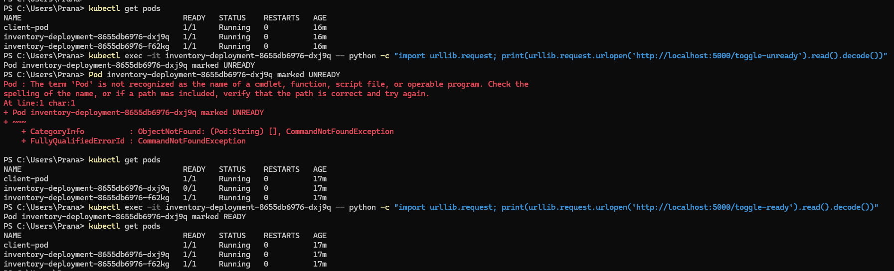
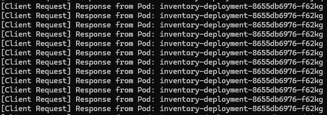
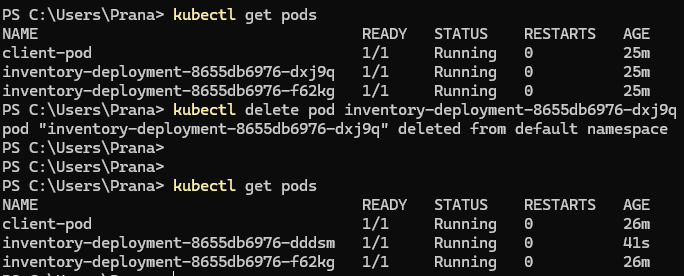
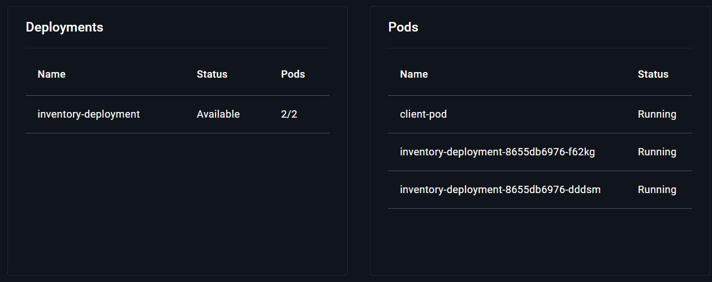

# Instructions for deploying the application.
    --> Build Docker : docker build -t inventory-app:latest .
    --> Apply k8 deployment : kubectl apply -f k8s/Deploy.yaml
    --> Verification : kubectl get pods

# Architecture Diagram
    

# Evidence of both replicas receiving requests.
    
    

# Evidence of the readiness failure and recovery.
    --> Verify current state using "kubectl get pods"
    
    --> to make one unready, we use : "kubectl exec -it inventory-deployment-8655db6976-dxj9q -- python -c "import urllib.request; print(urllib.request.urlopen('http://localhost:5000/toggle-unready').read().decode())"
Pod inventory-deployment-8655db6976-dxj9q marked UNREADY"

    --> Check new status using "kubectl get pods"
    
       

# Evidence of Pod deletion and replacement.
    00> Using "kubectl delete pod inventory-deployment-8655db6976-dxj9q" to delete selected pod
    --> Then to see "kubectl get pods" for replactement verification
    
    

# Screenshots, logs, or terminal output showing the system working.
    --> All screenshots should be in ./imgs folder

# A short 3–5 sentence reflection answering: "Why is a stable Service name useful when Pods can fail or be replaced?"
    --> Pods come and go, meaning their IP addresses change constantly whenever they crash, scale, or get replaced. A stable Service name gives clients a single, permanent address to talk to so they never have to worry about tracking changing IPs. This keeps communication smooth and keeps your app running reliably without needing manual updates.
